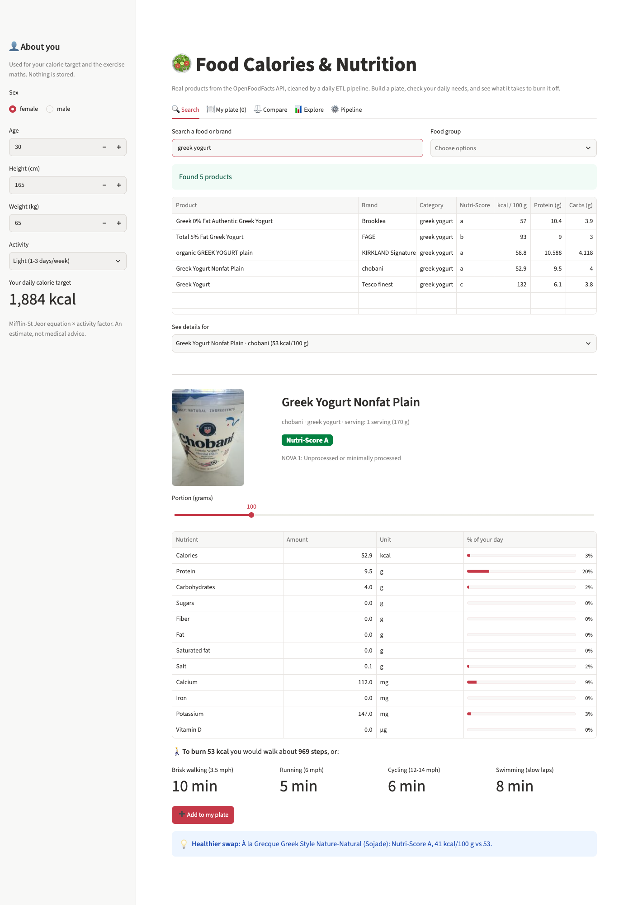
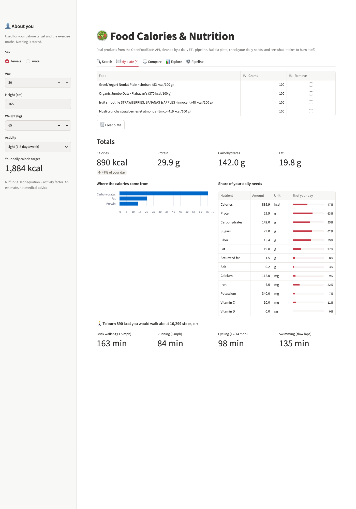
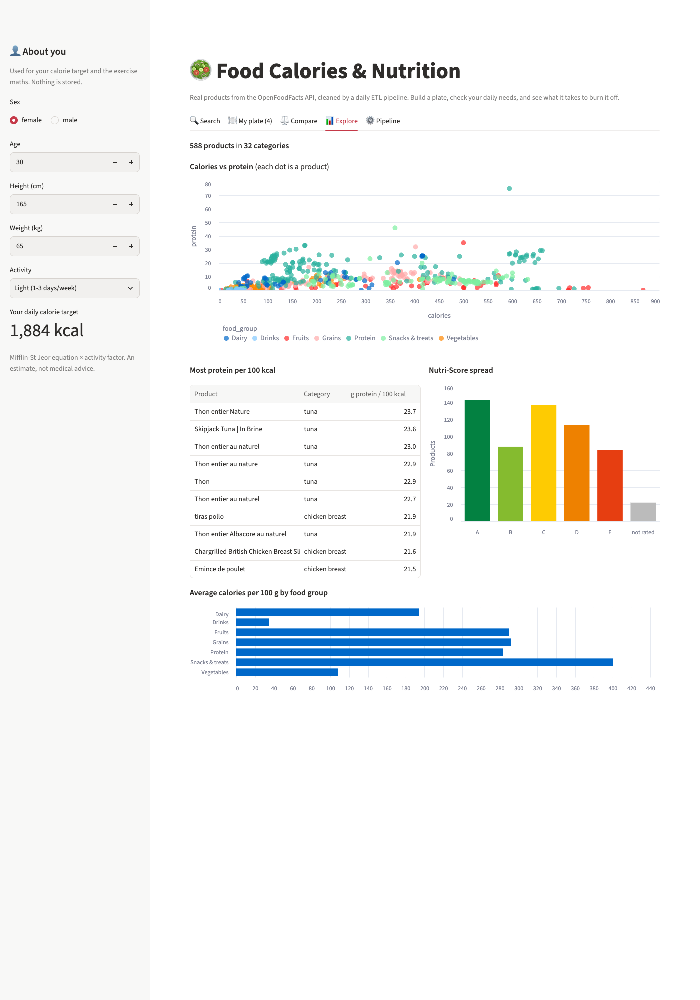
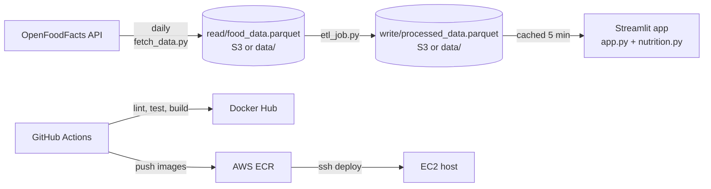

# Food Calories: a nutrition app on top of a daily data pipeline

[](https://github.com/Gunar-Oguz/food_calories/actions/workflows/ci-cd.yml)
[](https://github.com/Gunar-Oguz/food_calories/actions/workflows/refresh-data.yml)


**▶ [Open the live app](https://food-calories-gulnar.streamlit.app)**

Search real packaged foods, build a plate, see how it fits your personal daily needs, and find out how many
**steps** or **minutes of walking, running, cycling or swimming** it takes to burn it off. Behind the app is a
small but complete data pipeline that I built end to end: every day it pulls products from the
[OpenFoodFacts API](https://world.openfoodfacts.org/data), cleans them with an ETL job and republishes the app,
with tests, Docker images and CI/CD around every stage.



## Features

| | Feature | How it works |
|---|---|---|
| 🔍 | **Search** by food or brand, filter by food group | ~30 food types, up to 20 real products each |
| 🔬 | **Product details** | photo, [Nutri-Score](https://en.wikipedia.org/wiki/Nutri-Score) A–E, [NOVA](https://en.wikipedia.org/wiki/Nova_classification) processing level, 13 nutrients including vitamins and minerals when available |
| ⚖️ | **Any portion size** | slider from 10 g to 500 g; every number rescales |
| 🍽️ | **My plate** | add several foods with grams, edit or remove them, see totals and where the calories come from (protein / carbs / fat) |
| 🎯 | **Personal daily needs** | your calorie target from the [Mifflin-St Jeor equation](https://en.wikipedia.org/wiki/Basal_metabolic_rate) × activity level; each nutrient as "% of your day" against [FDA Daily Values](https://www.fda.gov/food/nutrition-facts-label/daily-value-nutrition-and-supplement-facts-labels), scaled to your calories |
| 🚶 | **Burn it off** | minutes of 4 activities and walking **steps**, from [MET values](https://pacompendium.com/) and your weight |
| 💡 | **Healthier swap** | a product of the same kind with a better Nutri-Score, or the same score and ≥ 10 % fewer calories |
| ⚖️ | **Compare** | 2–4 products side by side per 100 g |
| 📊 | **Explore** | calories vs protein for every product, most protein per 100 kcal, Nutri-Score spread, calories by food group |
| ⚙️ | **Pipeline** | last refresh time, product counts, and how complete each nutrient is in the data |

<p>
  
  
</p>

### The maths (all in [`nutrition.py`](nutrition.py), all unit-tested)

| Question | Formula |
|---|---|
| Nutrients in a portion | value per 100 g × grams / 100 |
| Calories from each macro | protein 4, carbs 4, fat 9 kcal per gram |
| Calories burned per minute | MET × 3.5 × weight (kg) / 200 |
| Steps | brisk-walking minutes × 100 steps/min ([moderate-intensity cadence](https://pubmed.ncbi.nlm.nih.gov/29858465/)) |
| Resting calories (BMR) | 10 × kg + 6.25 × cm − 5 × age, then +5 (male) or −161 (female) |
| Daily calorie target | BMR × activity factor (1.2 to 1.9) |

MET values from the [2024 Adult Compendium of Physical Activities](https://pacompendium.com/adult-compendium/):
brisk walking 3.5–3.9 mph **4.8** (code 17200), cycling 12–13.9 mph **8.0** (01030), slow freestyle laps **5.8** (18240),
running 6–6.3 mph **9.3** (12050). These are population averages, so the results are estimates for education,
not medical advice.

## Architecture



The same code runs in two setups, chosen by one environment variable (`S3_BUCKET`, see [`storage.py`](storage.py)):

| | Storage | Scheduler | App host |
|---|---|---|---|
| **Live now (free)** | `data/` folder in this repo | GitHub Actions cron ([`refresh-data.yml`](.github/workflows/refresh-data.yml)) | Streamlit Community Cloud |
| **AWS version** | S3 bucket | cron on EC2 running the fetch and ETL containers | Docker container on EC2, images from ECR |

| Stage | File | What it does |
|---|---|---|
| Fetch | `fetch_data.py` | Searches the API for ~30 foods (tagged with a food group), keeps 13 nutrients + Nutri-Score, NOVA, photo and serving size, forces numbers, saves raw parquet to `read/` |
| Transform | `etl_job.py` | Drops missing or impossible calories (> 900 kcal/100 g, since fat is ~9 kcal/g), blanks nutrients outside 0–100 g/100 g, normalises Nutri-Score and NOVA, removes duplicates by name+brand and barcode, saves to `write/` |
| Serve | `app.py` | User interface only: tabs, widgets, charts |
| Logic | `nutrition.py` | Pure functions for every calculation; no Streamlit, no I/O |
| Storage | `storage.py` | Reads and writes parquet to S3 when `S3_BUCKET` is set, and to `data/` otherwise, with the same paths |

The **raw** and **processed** data live in separate folders on purpose: if a bad transform ships, I can rerun
the ETL on the untouched raw data instead of calling the API again.

## Run it in one minute (no AWS account needed)

The latest processed data is committed in `data/`, so the app works straight after cloning.

```bash
git clone https://github.com/Gunar-Oguz/food_calories.git && cd food_calories
docker build -t food-calories .
docker run -p 8501:8501 food-calories
# open http://localhost:8501
```

Or without Docker:

```bash
python -m venv .venv && source .venv/bin/activate
pip install -r requirements-dev.txt
pytest                     # 31 tests, no network, no AWS, about 2 seconds
python fetch_data.py       # API -> data/read/   (about 5 minutes: it respects the API rate limit)
python etl_job.py          # data/read/ -> data/write/
streamlit run app.py
```

To run on AWS instead, configure credentials (`aws configure`), `export S3_BUCKET=<your bucket>`, and run the same
three commands.

## Tests

31 tests in three files. **No test touches the internet or real AWS**: S3 is faked with
[moto](https://github.com/getmoto/moto), and the API with a fake HTTP session.

- **[`test_nutrition.py`](tests/test_nutrition.py)**: every formula against hand-calculated values (Mifflin-St Jeor,
  MET minutes, steps, 4/4/9 macro split, unit conversion g → mg → µg, Daily Value scaling, healthier-swap rules)
- **[`test_app.py`](tests/test_app.py)**: the pipeline
  - API parsing handles missing fields and numbers sent as strings (`"265"`, `"n/a"`)
  - if one search fails the rest are kept; if all fail, or time runs out, old data is never replaced by nothing
  - the transform removes nulls, duplicates and impossible values, and does not change its input
  - end to end on both backends: raw file in fake S3 or a temp folder → ETL → the app finds the right row
- **[`test_ui.py`](tests/test_ui.py)**: runs the real app headless with Streamlit's `AppTest` and clicks through it:
  every tab renders, a search shows details and burn-off, "Add to my plate" updates the totals, and changing
  your weight changes your calorie target

## CI/CD

**[`refresh-data.yml`](.github/workflows/refresh-data.yml)** runs the pipeline every day at 10:00 UTC and commits
`data/` only if the data changed. Streamlit Cloud redeploys on that commit, so the live app stays fresh with no server.

**[`ci-cd.yml`](.github/workflows/ci-cd.yml)** runs on every push and pull request:

1. **Lint and test** on Python 3.11 and 3.14: `ruff check` and `pytest`
2. **Docker**: builds all three images with a build matrix (so a broken Dockerfile fails the PR), and on `main` pushes
   them to Docker Hub tagged with both `latest` and the commit SHA
3. **AWS deploy**, on only when the repository variable `AWS_DEPLOY=true`: pushes the images to ECR, then connects to
   EC2 over SSH, restarts the app container and installs the two cron jobs. It is off now, because the live app
   runs on the free setup.

### Secrets handling

All credentials are GitHub Secrets. During deploy, the AWS keys are written to an owner-only env file on the server
(`umask 077`), and the containers read it with `--env-file`. That keeps keys out of the code, the crontab and the
`ps` process list.

This design came from a real mistake. An earlier version had keys pasted inside the workflow file. I revoked those
keys, removed them from the entire git history, and moved to the setup above. A next step is an **IAM instance role**
on the EC2 host, so there are no long-lived keys on the server at all.

## Design decisions and trade-offs

- **Logic separate from the UI**: `nutrition.py` has no Streamlit import, so every formula is tested in milliseconds,
  and the same functions could back an API later.
- **One storage switch instead of two code paths**: `storage.py` hides S3 vs local behind `read_parquet` /
  `write_parquet`, so moving from AWS to the free setup changed zero lines in the fetch, ETL or app logic.
- **Being polite to a public API, and defensive about it**: OpenFoodFacts allows about 10 searches a minute, so the
  fetch pauses between searches and retries `429`/`5xx` with capped exponential backoff. The server's `Retry-After`
  is ignored and the whole run has a 15-minute limit, because one reply once froze a run for over an hour.
- **Unknown is not zero**: a missing nutrient stays empty in a single product, so the app never shows "0 g fiber" when
  the label simply did not say. In plate totals it counts as 0, which makes totals a lower bound, and the Pipeline tab
  shows how complete each nutrient is.
- **Personal targets, not one number for everyone**: FDA Daily Values assume 2,000 kcal; the energy-based ones
  (fat, carbs, protein, sugar, fiber) are scaled to your own calorie target, while salt and micronutrients are not.
- **Parquet over CSV**: typed columns, compressed, and read directly from bytes in memory.
- **Cron instead of Airflow**: two daily jobs with one dependency don't need a scheduler cluster. In GitHub Actions
  the ETL step runs only if fetch succeeded. Airflow or Step Functions would be the upgrade if more stages were added.
- **Three small images instead of one**, **non-root containers**, and a Docker `HEALTHCHECK` on the app.

## What I learned

- Real APIs fail in more than one way: `503` errors led to retries and "skip one, keep the rest"; a frozen run led to
  capped backoff and a time limit. Each failure became a test.
- Splitting code into **pure functions** (`parse_products`, `transform`, everything in `nutrition.py`) with thin I/O
  around them is what made it testable without AWS or a browser.
- Testing a UI for real with Streamlit's `AppTest`, and handling state (the plate) across reruns.
- Mocking cloud services with moto, and why a test that silently reaches real AWS is a bad test.
- Secret management the hard way, and how git history keeps everything you ever committed.

## Project structure

```
├── app.py                 Streamlit app (UI only)
├── nutrition.py           all nutrition and exercise maths (pure functions)
├── fetch_data.py          API → raw
├── etl_job.py             raw → clean → processed
├── storage.py             S3 or local data/, same paths
├── tests/                 31 tests: nutrition, pipeline, UI
├── data/                  latest data, refreshed daily by GitHub Actions
├── docs/                  screenshots
├── Dockerfile             app image
├── Dockerfile.etl         ETL job image
├── Dockerfile.fetch       fetch job image
├── .github/workflows/     ci-cd.yml, refresh-data.yml
├── requirements.txt       runtime dependencies
└── requirements-dev.txt   + pytest, moto, ruff
```

---

**Gulnar Albushova**, UC Berkeley Master of Information and Data Science (MIDS)
· [LinkedIn](https://www.linkedin.com/in/gulnar-albushova-253252140/) · [GitHub](https://github.com/Gunar-Oguz)
