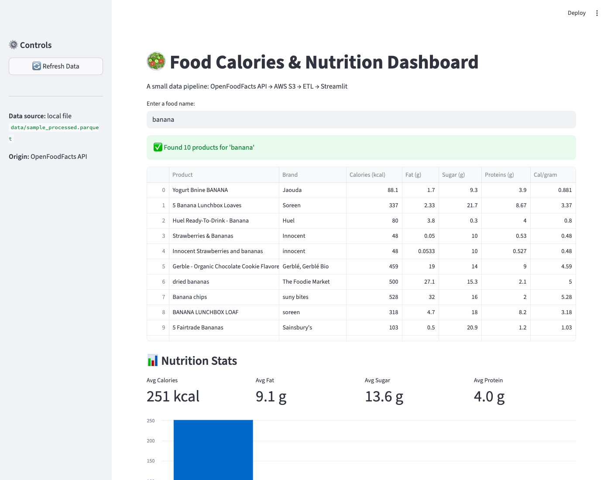
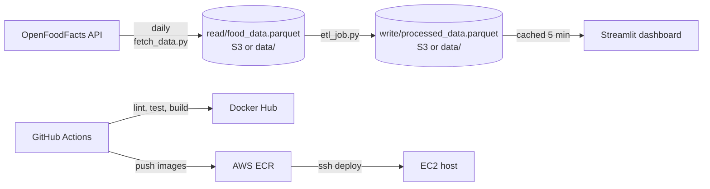

# Food Calories: an API → S3 → ETL → dashboard pipeline on AWS

[](https://github.com/Gunar-Oguz/food_calories/actions/workflows/ci-cd.yml)
[](https://github.com/Gunar-Oguz/food_calories/actions/workflows/refresh-data.yml)


A small, complete data pipeline that I built and deployed end to end. Every day it pulls nutrition facts
from the [OpenFoodFacts API](https://world.openfoodfacts.org/data), stores the raw data, cleans it with
an ETL job, and serves a searchable Streamlit dashboard. Each stage is its own Docker image, and GitHub Actions
tests, builds and ships them.

**▶ [Live demo](https://food-calories-gulnar.streamlit.app)**: data refreshed daily by GitHub Actions.

The same code runs in two setups, chosen by one environment variable (`S3_BUCKET`, see [`storage.py`](storage.py)):

| | Storage | Scheduler | Dashboard host |
|---|---|---|---|
| **Live now (free)** | `data/` folder in this repo | GitHub Actions cron ([`refresh-data.yml`](.github/workflows/refresh-data.yml)) | Streamlit Community Cloud |
| **AWS version** | S3 bucket | cron on EC2 running the fetch and ETL containers | Docker container on EC2, images from ECR |



## Architecture



| Stage | File | What it does |
|---|---|---|
| Fetch | `fetch_data.py` | Searches the API for 5 foods, flattens the nested JSON, forces nutrients to numbers, saves raw parquet to `read/` |
| Transform | `etl_job.py` | Drops rows with missing calories, drops physically impossible values (> 900 kcal per 100 g, since fat is ~9 kcal/g), removes duplicates, adds `calories_per_gram`, saves to `write/` |
| Serve | `app.py` | Reads the processed file, searches by name, shows a table, averages and a chart |
| Storage | `storage.py` | One small module that reads and writes parquet to S3 when `S3_BUCKET` is set, and to `data/` otherwise, with the same paths |

The **raw** and **processed** data live in separate folders on purpose: if a bad transform ships, I can rerun
the ETL on the untouched raw data instead of calling the API again.

## Run it in one minute (no AWS account needed)

The latest processed data is committed in `data/`, so the app works straight after cloning.

```bash
git clone https://github.com/Gunar-Oguz/food_calories.git && cd food_calories
docker build -t food-calories .
docker run -p 8501:8501 food-calories
# open http://localhost:8501
```

Or without Docker:

```bash
python -m venv .venv && source .venv/bin/activate
pip install -r requirements-dev.txt
pytest                     # 11 tests, no network, no AWS
python fetch_data.py       # API -> data/read/
python etl_job.py          # data/read/ -> data/write/
streamlit run app.py
```

To run on AWS instead, configure credentials (`aws configure`), `export S3_BUCKET=<your bucket>`, and run the same
three commands.

## Tests

`tests/test_app.py` covers each stage and the whole pipeline. **No test touches the internet or real AWS**: S3 is
faked with [moto](https://github.com/getmoto/moto), and the API with a fake HTTP session.

- API parsing handles missing fields and numbers sent as strings (`"265"`, `"n/a"`)
- if one API search fails the rest are kept, and if every search fails the job stops instead of overwriting good data
- the transform removes nulls, duplicates and impossible values, and does not change its input
- end-to-end tests on both backends: raw file in fake S3 or a temp folder → ETL → the dashboard search finds the right row
- the search is case-insensitive and safe with symbols like `(` (no regex surprises)
- the app works from the committed data, and shows an empty result (not a crash) when S3 has no data yet

## CI/CD

Two workflows:

**[`refresh-data.yml`](.github/workflows/refresh-data.yml)** runs the pipeline every day at 10:00 UTC and commits
`data/` only if the data changed. Streamlit Cloud redeploys on that commit, so the live demo stays fresh with no server.

**[`ci-cd.yml`](.github/workflows/ci-cd.yml)** runs on every push and pull request:

1. **Lint and test** on Python 3.11 and 3.14: `ruff check` and `pytest`
2. **Docker**: builds all three images with a build matrix (so a broken Dockerfile fails the PR), and on `main` pushes
   them to Docker Hub tagged with both `latest` and the commit SHA
3. **AWS deploy**, on only when the repository variable `AWS_DEPLOY=true`: pushes the images to ECR, then connects to
   EC2 over SSH, restarts the dashboard container and installs the two cron jobs. It is off now, because the live demo
   runs on the free setup.

### Secrets handling

All credentials are GitHub Secrets. During deploy, the AWS keys are written to an owner-only env file on the server
(`umask 077`), and the containers read it with `--env-file`. That keeps keys out of the code, the crontab and the
`ps` process list.

This design came from a real mistake. An earlier version had keys pasted inside the workflow file. I revoked those
keys, removed them from the entire git history, and moved to the setup above. A next step is an **IAM instance role**
on the EC2 host, so there are no long-lived keys on the server at all.

## Design decisions and trade-offs

- **One storage switch instead of two code paths**: `storage.py` hides S3 vs local behind `read_parquet` /
  `write_parquet`, so moving from AWS to the free setup changed zero lines in the fetch, ETL or app logic.
- **Being polite to a public API**: OpenFoodFacts allows about 10 searches a minute, so the fetch pauses between
  searches and retries `429`/`5xx` with exponential backoff (2, 4, 8… seconds).
- **Parquet over CSV**: typed columns (calories stay floats), compressed, and read directly from bytes in memory.
- **Cron instead of Airflow**: two daily jobs with one dependency don't need a scheduler cluster. In GitHub Actions
  the ETL step runs only if fetch succeeded. On EC2 they were linked only by time (10:00 and 10:15), not by success. Airflow or Step Functions
  would be the upgrade if more stages were added.
- **Three small images instead of one**: each job ships only the script it runs, and they can be rebuilt and
  scheduled independently.
- **Non-root containers** and a Docker `HEALTHCHECK` on the dashboard.

## What I learned

- Real APIs fail: the first live run got `503` errors, which is why retries, backoff and "skip one, keep the rest" exist.
- Splitting a pipeline into **pure functions** (`parse_products`, `transform`, `search_foods`) and thin I/O
  around them is what made it testable without AWS.
- Mocking cloud services with moto, and why a test that silently reaches real AWS is a bad test.
- Building and pushing images to two registries from one workflow, and gating a deploy behind a flag.
- Secret management the hard way, and how git history keeps everything you ever committed.

## Project structure

```
├── app.py                 Streamlit dashboard
├── fetch_data.py          API → S3 raw
├── etl_job.py             raw → clean → processed
├── storage.py             S3 or local data/, same paths
├── tests/test_app.py      11 tests (moto + fake HTTP session)
├── data/                  latest data, refreshed daily by GitHub Actions
├── Dockerfile             dashboard image
├── Dockerfile.etl         ETL job image
├── Dockerfile.fetch       fetch job image
├── .github/workflows/     ci-cd.yml, refresh-data.yml
├── requirements.txt       runtime dependencies
└── requirements-dev.txt   + pytest, moto, ruff
```

---

**Gulnar Albushova**, UC Berkeley Master of Information and Data Science (MIDS)
· [LinkedIn](https://www.linkedin.com/in/gulnar-albushova-253252140/) · [GitHub](https://github.com/Gunar-Oguz)
