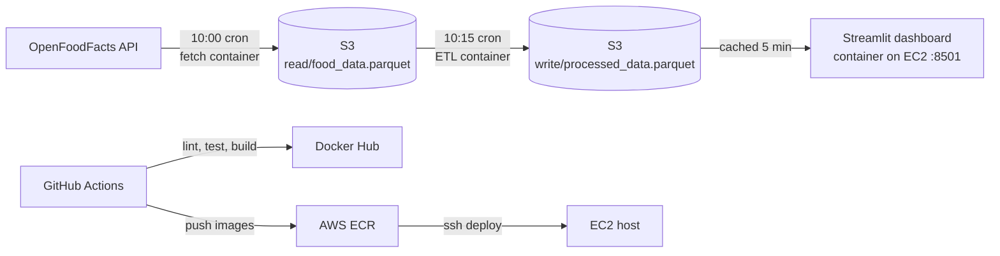

# Food Calories: an API → S3 → ETL → dashboard pipeline on AWS

[](https://github.com/Gunar-Oguz/food_calories/actions/workflows/ci-cd.yml)


A small, complete data pipeline that I built and deployed end to end. Every day it pulls nutrition facts
from the [OpenFoodFacts API](https://world.openfoodfacts.org/data), stores the raw data in S3, cleans it with
an ETL job, and serves a searchable Streamlit dashboard. Each stage is its own Docker image, and GitHub Actions
tests, builds, pushes and deploys them to AWS.


## Architecture



| Stage | File | What it does |
|---|---|---|
| Fetch | `fetch_data.py` | Searches the API for 5 foods, flattens the nested JSON, forces nutrients to numbers, uploads raw parquet to `s3://…/read/` |
| Transform | `etl_job.py` | Drops rows with missing calories, drops physically impossible values (> 900 kcal per 100 g, since fat is ~9 kcal/g), removes duplicates, adds `calories_per_gram`, writes to `s3://…/write/` |
| Serve | `app.py` | Reads the processed file (S3, or a local file through `DATA_PATH`), searches by name, shows a table, averages and a chart |

The **raw** and **processed** data live in separate S3 prefixes on purpose: if a bad transform ships, I can rerun
the ETL on the untouched raw data instead of calling the API again.

## Run it in one minute (no AWS account needed)

The repo includes a small sample of real processed data (`data/sample_processed.parquet`, 49 products).

```bash
git clone https://github.com/Gunar-Oguz/food_calories.git && cd food_calories
docker build -t food-calories .
docker run -p 8501:8501 -e DATA_PATH=data/sample_processed.parquet food-calories
# open http://localhost:8501
```

Or without Docker:

```bash
python -m venv .venv && source .venv/bin/activate
pip install -r requirements-dev.txt
pytest                                              # 8 tests, all on a fake S3 (moto), no network
DATA_PATH=data/sample_processed.parquet streamlit run app.py
```

To run against real AWS, configure credentials (`aws configure`), optionally set `S3_BUCKET`, then run
`python fetch_data.py`, `python etl_job.py` and `streamlit run app.py`.

## Tests

`tests/test_app.py` covers each stage and the whole pipeline. **No test touches the internet or real AWS**: S3 is
faked with [moto](https://github.com/getmoto/moto), and the API with a monkeypatched `requests.get`.

- API parsing handles missing fields and numbers sent as strings (`"265"`, `"n/a"`)
- the transform removes nulls, duplicates and impossible values, and does not change its input
- an end-to-end test: raw file in fake S3 → ETL → the dashboard search finds the right row
- the search is case-insensitive and safe with symbols like `(` (no regex surprises)
- the app works from a local file, and shows an empty result (not a crash) when S3 has no data yet

## CI/CD

[`.github/workflows/ci-cd.yml`](.github/workflows/ci-cd.yml) runs on every push and pull request:

1. **Lint and test**: `ruff check` and `pytest`
2. **Docker**: builds all three images with a build matrix (so a broken Dockerfile fails the PR), and on `main` pushes
   them to Docker Hub tagged with both `latest` and the commit SHA
3. **AWS deploy**, on when the repository variable `AWS_DEPLOY=true`: pushes the images to ECR, then connects to EC2
   over SSH, restarts the dashboard container and installs the two cron jobs

### Secrets handling

All credentials are GitHub Secrets. During deploy, the AWS keys are written to an owner-only env file on the server
(`umask 077`), and the containers read it with `--env-file`. That keeps keys out of the code, the crontab and the
`ps` process list.

This design came from a real mistake. An earlier version had keys pasted inside the workflow file. I revoked those
keys, removed them from the entire git history, and moved to the setup above. A next step is an **IAM instance role**
on the EC2 host, so there are no long-lived keys on the server at all.

## Design decisions and trade-offs

- **Parquet over CSV**: typed columns (calories stay floats), compressed, and read directly from bytes in memory.
- **Cron + containers instead of Airflow**: two daily jobs with one dependency don't need a scheduler cluster.
  The cost is that fetch and ETL are linked only by time (10:00 and 10:15), not by success. Airflow or Step Functions
  would be the upgrade if more stages were added.
- **Three small images instead of one**: each job ships only the script it runs, and they can be rebuilt and
  scheduled independently.
- **Non-root containers** and a Docker `HEALTHCHECK` on the dashboard.

## What I learned

- Splitting a pipeline into **pure functions** (`parse_products`, `transform`, `search_foods`) and thin I/O
  around them is what made it testable without AWS.
- Mocking cloud services with moto, and why a test that silently reaches real AWS is a bad test.
- Building and pushing images to two registries from one workflow, and gating a deploy behind a flag.
- Secret management the hard way, and how git history keeps everything you ever committed.

## Project structure

```
├── app.py                 Streamlit dashboard
├── fetch_data.py          API → S3 raw
├── etl_job.py             S3 raw → clean → S3 processed
├── tests/test_app.py      8 tests (moto + monkeypatch)
├── data/                  small sample for running without AWS
├── Dockerfile             dashboard image
├── Dockerfile.etl         ETL job image
├── Dockerfile.fetch       fetch job image
├── .github/workflows/     CI/CD
├── requirements.txt       runtime dependencies
└── requirements-dev.txt   + pytest, moto, ruff
```

---

**Gulnar Albushova**, UC Berkeley Master of Information and Data Science (MIDS)
· [LinkedIn](https://www.linkedin.com/in/gulnar-albushova-253252140/) · [GitHub](https://github.com/Gunar-Oguz)
